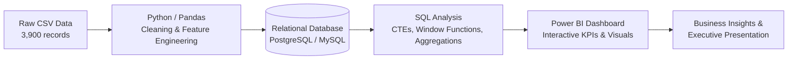

# 📊 Retail Customer Shopping Behavior & Trends Analysis

An end-to-end data analytics project exploring customer demographics, purchase drivers, subscription behavior, and transaction patterns to derive actionable business intelligence.

---

## 📌 Executive Summary

Modern retail businesses generate vast quantities of transactional data. The objective of this project is to model, query, and visualize customer shopping behavior across 3,900 retail transactions to uncover revenue opportunities, improve customer retention, and optimize discounting strategies.

The analysis follows an industry-standard analytics lifecycle:
1. **Data Cleaning & Feature Engineering (Python / Pandas):** Handling missing values, standardizing schema, and segmenting age and purchase frequencies.
2. **Relational Database Modeling & SQL Analysis (PostgreSQL / MySQL):** Querying transaction patterns, customer loyalty tiers, and discount dependencies.
3. **Business Intelligence & Visualization (Power BI):** Interactive multi-page dashboard tracking revenue KPIs, demographic distribution, and retention drivers.
4. **Stakeholder Presentation & Documentation:** Structured business problem statement, analytical report, and executive slide deck.

---

## 🏗️ Architecture & Workflow



---

## 📁 Repository Structure

```text
├── Business Problem Document.pdf           # Project scope, business goals & questions
├── Customer Shopping Behavior Analysis.pdf # Comprehensive analysis report
├── Customer-Shopping-Behavior-Analysis.pptx # Stakeholder presentation deck
├── Customer_Shopping_Behavior_Analysis.ipynb# Python data cleaning & DB pipeline
├── customer_behavior_dashboard.pbix        # Interactive Power BI dashboard file
├── customer_behavior_sql_queries.sql       # 10 core analytical SQL queries
├── customer_shopping_behavior.csv          # Raw transaction dataset
└── README.md                               # Project documentation
```

---

## 💾 Dataset Overview

The dataset contains **3,900 customer records** across **18 attributes**:

| Feature | Type | Description |
| :--- | :--- | :--- |
| `Customer ID` | Numerical | Unique identifier for each shopper |
| `Age` | Numerical | Shopper age (18 to 70 years) |
| `Gender` | Categorical | Male / Female |
| `Item Purchased` | Categorical | Specific apparel, footwear, or accessory item |
| `Category` | Categorical | Clothing, Footwear, Outerwear, Accessories |
| `Purchase Amount (USD)` | Numerical | Value of purchase ($20 to $100) |
| `Location` | Categorical | U.S. State of purchase |
| `Size` & `Color` | Categorical | Product variations |
| `Season` | Categorical | Spring, Summer, Fall, Winter |
| `Review Rating` | Numerical | Product satisfaction rating (2.5 - 5.0) |
| `Subscription Status` | Categorical | Whether shopper holds an active membership (Yes / No) |
| `Shipping Type` | Categorical | Standard, Express, Free Shipping, Next Day Air, etc. |
| `Discount Applied` | Categorical | Discount status (Yes / No) |
| `Previous Purchases` | Numerical | Count of historical purchases (1 - 50) |
| `Payment Method` | Categorical | Credit Card, PayPal, Venmo, Cash, etc. |
| `Frequency of Purchases` | Categorical | Fortnightly, Weekly, Monthly, Annually, etc. |

---

## ⚙️ Analytical Methodology

### 1. Data Ingestion & Engineering (Python)
- **Null Value Imputation:** Imputed missing values in `Review Rating` using median values grouped by product `Category`.
- **Schema Normalization:** Standardized column names to `snake_case` for SQL compatibility.
- **Feature Engineering:**
  - `age_group`: Segmented customer ages into quantiles (`Young Adult`, `Adult`, `Middle-aged`, `Senior`).
  - `purchase_frequency_days`: Mapped purchase frequency text categories into numerical day intervals (e.g., Weekly = 7, Monthly = 30).
  - Dropped redundant redundant columns (`promo_code_used` was identical to `discount_applied`).
- **Database Export:** Automatically loaded the transformed dataset into PostgreSQL / MySQL via SQLAlchemy.

### 2. Business Intelligence Queries (SQL)
Key queries formulated in `customer_behavior_sql_queries.sql` include:
1. **Demographic Revenue Split:** Aggregate revenue generated by male vs. female shoppers.
2. **High-Value Discount Users:** Identifying customers who utilized promotional discounts yet spent above average order value.
3. **Top Rated Products:** Ranking top 5 products by average customer satisfaction score.
4. **Shipping Tier Comparison:** Analyzing purchase amount differences between standard and express fulfillment methods.
5. **Subscription Economics:** Comparing average order value (AOV) and gross revenue between subscribers and non-subscribers.
6. **Discount Penetration:** Computing percentage of sales driven by discounts across each product.
7. **Customer Loyalty Segmentation:** Categorizing shoppers into `New` (1 purchase), `Returning` (2–10), and `Loyal` (>10) cohorts using CTEs and conditional logic.
8. **Category Product Rankings:** Identifying top 3 highest-volume items per category using `ROW_NUMBER()` window functions.
9. **Repeat Buyer Conversion:** Assessing subscription adoption rate among repeat buyers (>5 prior orders).
10. **Age Group Contribution:** Revenue breakdown across segmented generational brackets.

### 3. Data Visualization (Power BI)
- **Executive KPI Cards:** Total Revenue, Total Orders, Average Order Value (AOV), and Average Review Rating.
- **Sales by Category & Item:** Bar and column visuals highlighting best-selling product lines.
- **Demographic Breakdown:** Donut and ribbon charts tracking revenue by Gender and Age Bracket.
- **Subscription & Loyalty Dynamics:** Conversion trends comparing recurring subscribers to occasional shoppers.

---

## 📈 Key Findings & Insights

* **Revenue Distribution:** Male customers generate the majority of total transaction volume and gross revenue across the analyzed dataset.
* **Subscription Value:** While non-subscribers account for a larger gross customer volume, subscribers demonstrate consistent purchase frequency and predictable recurring revenue.
* **Discount Drivers:** Discounts heavily incentivize sales volume across top items, but a significant segment of discount users consistently spend well above the average transaction threshold, representing prime upsell candidates.
* **Loyalty Cohorts:** The majority of customers fall into the `Returning` and `Loyal` brackets, indicating solid customer retention potential that can be enhanced through targeted loyalty rewards.

---

## 🚀 How to Run Locally

### Prerequisites
- Python 3.9+
- PostgreSQL or MySQL
- Power BI Desktop (Windows)

### Step 1: Clone the Repository
```bash
git clone https://github.com/<your-username>/customer-trends-data-analysis.git
cd customer-trends-data-analysis
```

### Step 2: Set Up Python Environment
```bash
pip install pandas sqlalchemy psycopg2-binary pymysql
```

### Step 3: Run Data Transformation Pipeline
Open and execute `Customer_Shopping_Behavior_Analysis.ipynb` in Jupyter Notebook or VS Code to clean data and load it into your local SQL database.

### Step 4: Execute SQL Queries
Connect to your database via pgAdmin, MySQL Workbench, or DBeaver and run `customer_behavior_sql_queries.sql`.

### Step 5: Explore Power BI Dashboard
Open `customer_behavior_dashboard.pbix` in Power BI Desktop to inspect the visualizations, DAX calculations, and reports.


